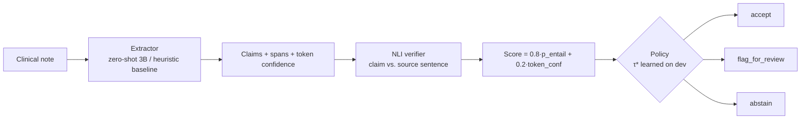

# Veritas-Clin

Clinical notes in → structured findings out — where every claim carries a **source
span**, a **calibrated score**, and an explicit decision: **accept / flag_for_review /
abstain**. Extraction claims are re-checked against the source note by an NLI verifier
before anything is allowed near the output.

> Academic one-night build. **Synthetic data only — no PHI, no clinical validity claim.**

## The gap this addresses

LLMs on clinical text hallucinate (wrong dosages, conditions merely "ruled out",
family history) while staying overconfident. The engineering answer built here:



## What is measured (nothing hand-waved)

- Per-type precision/recall/F1 against ground truth known *by construction* (synthetic corpus
  with planted traps: ruled-out diagnoses, family history, allergy-line drugs).
- **ECE** (expected calibration error), dev + test.
- **Risk–coverage curve** on test.
- **Hallucination capture**: fraction of incorrect claims that the policy flagged or abstained on.

## Experimental Results (Colab T4 GPU Benchmark)

Evaluated across the 40-note corpus (20 dev / 20 test) using **Qwen2.5-3B-Instruct** (fp16) for extraction and **DeBERTa-v3-base-mnli-fever-anli** for NLI verification. The decision threshold $\tau^* = 0.35$ was learned exclusively on the dev split and evaluated strictly on the held-out test split.

### 1. Extraction Performance (Test Split)

| Finding Type | Precision | Recall | F1 | True Pos (TP) | False Pos (FP) | False Neg (FN) |
|---|---|---|---|---|---|---|
| **Diagnosis** | 77.2% | 100.0% | **87.1%** | 44 | 13 | 0 |
| **Medication** | 90.6% | 100.0% | **95.1%** | 29 | 3 | 0 |
| **Follow-up** | 100.0% | 95.0% | **97.4%** | 19 | 0 | 1 |
| **Aggregate** | 85.2% | 98.9% | **91.5%** | 92 | 16 | 1 |

*Note on False Positives:* The 13 diagnosis FPs correspond precisely to the planted clinical traps (e.g. conditions explicitly noted as *"ruled out"* or appearing only in *"Family history"*), which zero-shot models eagerly extract without verification.

### 2. Calibration & Abstention Policy (Test Split)

| Metric | Measured Value | Significance |
|---|---|---|
| **Raw Extraction Precision** | 85.2% | Baseline un-calibrated LLM output |
| **Accepted Precision ($P_{\text{accept}}$)** | **92.9%** | Precision among claims accepted by policy (+7.7% boost) |
| **Test Coverage** | **90.7%** | Fraction of claims auto-accepted into chart |
| **Hallucination Capture Rate** | **56.2%** | Fraction of false-positive claims caught & suppressed |
| **Expected Calibration Error (ECE)** | **0.1353** (Test), 0.1500 (Dev) | Probability-to-empirical-accuracy error |
| **Threshold ($\tau^*$)** | **0.3499** | F1-optimal cutoff selected on dev split |

Generated plots are stored under `artifacts/plots/`:
- `artifacts/plots/calibration.png`: Reliability diagram comparing confidence vs observed empirical accuracy.
- `artifacts/plots/risk_coverage.png`: Selective risk curve as coverage expands.

## Quickstart

```bash
python -m venv .venv && source .venv/bin/activate
pip install -e .

# offline smoke (no GPU, no downloads):
python -m pytest

# full offline eval:
python -m veritas_clin.eval --extractor heuristic --no-nli

# GPU eval + server (Colab T4 or local CUDA; downloads ~7 GB of model weights):
pip install "torch>=2.1" transformers accelerate
python -m veritas_clin.eval --extractor hf
uvicorn veritas_clin.serve:app --port 8000
curl -s localhost:8000/extract -H 'content-type: application/json' \
  -d '{"note_id":"demo","note_text":"DISCHARGE SUMMARY ..."}'
```

The Colab notebook `notebooks/veritas_end_to_end.ipynb` reproduces the GPU path in one pass.

## Repo map

```
src/veritas_clin/
  schemas.py    Pydantic contracts (Claim, VerifiedClaim, request/response)
  config.py     model ids, thresholds, paths — nothing else hard-codes these
  data_gen.py   deterministic corpus generator + ground truth + traps
  extract.py    Extractor protocol; HeuristicExtractor; HuggingFaceExtractor (zero-shot 3B)
  verify.py     NLI verification layer (label-scheme-agnostic adapter)
  calibrate.py  pure math: ECE, risk–coverage, threshold selection, 3-way policy
  pipeline.py   extractor -> verifier -> score -> decisions (shared by eval + serve)
  eval.py       dev/test protocol, metrics.json, plots
  serve.py      FastAPI /health /extract
tests/          15 offline tests (no network, no GPU)
docs/           PRD + ARCHITECTURE
```

## Honest status

**Built tonight:** full pipeline, calibration protocol, service, offline tests, synthetic
corpus with plausibility traps. **Not built (Phase 2, deliberately):** QLoRA fine-tuning
comparison, MedNLI-tuned verifier, conformal prediction, real credentialed corpora.
Any wall-clock claim about real clinical deployments is explicitly out of scope.
