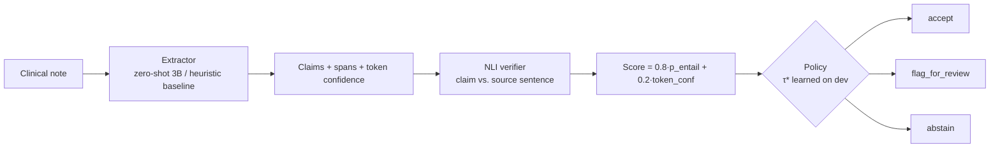

# Veritas-Clin

Clinical notes in → structured findings out — where every claim carries a **source
span**, a **calibrated score**, and an explicit decision: **accept / flag_for_review /
abstain**. Extraction claims are re-checked against the source note by an NLI verifier
before anything is allowed near the output.

> Academic one-night build. **Synthetic data only — no PHI, no clinical validity claim.**

## The gap this addresses

LLMs on clinical text hallucinate (wrong dosages, conditions merely "ruled out",
family history) while staying overconfident. The engineering answer built here:



## What is measured (nothing hand-waved)

- Per-type precision/recall/F1 against ground truth known *by construction* (synthetic corpus
  with planted traps: ruled-out diagnoses, family history, allergy-line drugs).
- **ECE** (expected calibration error), dev + test.
- **Risk–coverage curve** on test.
- **Hallucination capture**: fraction of incorrect claims that the policy flagged or abstained on.

## Quickstart

```bash
python -m venv .venv && source .venv/bin/activate
pip install -e .

# offline smoke (no GPU, no downloads):
python -m pytest

# full offline eval:
python -m veritas_clin.eval --extractor heuristic --no-nli

# GPU eval + server (Colab T4 or local CUDA; downloads ~7 GB of model weights):
pip install "torch>=2.1" transformers accelerate
python -m veritas_clin.eval --extractor hf
uvicorn veritas_clin.serve:app --port 8000
curl -s localhost:8000/extract -H 'content-type: application/json' \
  -d '{"note_id":"demo","note_text":"DISCHARGE SUMMARY ..."}'
```

The Colab notebook `notebooks/veritas_end_to_end.ipynb` reproduces the GPU path in one pass.

## Repo map

```
src/veritas_clin/
  schemas.py    Pydantic contracts (Claim, VerifiedClaim, request/response)
  config.py     model ids, thresholds, paths — nothing else hard-codes these
  data_gen.py   deterministic corpus generator + ground truth + traps
  extract.py    Extractor protocol; HeuristicExtractor; HuggingFaceExtractor (zero-shot 3B)
  verify.py     NLI verification layer (label-scheme-agnostic adapter)
  calibrate.py  pure math: ECE, risk–coverage, threshold selection, 3-way policy
  pipeline.py   extractor -> verifier -> score -> decisions (shared by eval + serve)
  eval.py       dev/test protocol, metrics.json, plots
  serve.py      FastAPI /health /extract
tests/          15 offline tests (no network, no GPU)
docs/           PRD + ARCHITECTURE
```

## Honest status

**Built tonight:** full pipeline, calibration protocol, service, offline tests, synthetic
corpus with plausibility traps. **Not built (Phase 2, deliberately):** QLoRA fine-tuning
comparison, MedNLI-tuned verifier, conformal prediction, real credentialed corpora.
Any wall-clock claim about real clinical deployments is explicitly out of scope.
