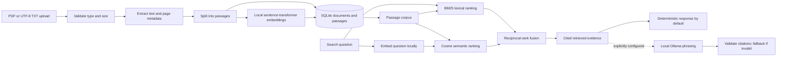

# Architecture — Veritas-Clin

## Data and request flow

## Components

- `document_store.py`: SQLite persistence for document metadata, passage text, and float32 embedding blobs. Foreign keys cascade document deletion to passages.
- `document_nlp.py`: PDF/TXT validation and extraction, page-aware chunking, lazy local sentence-transformer embeddings, BM25, cosine similarity, reciprocal-rank fusion, and synthetic fixture seeding.
- `response_agent.py`: deterministic evidence formatting and optional Ollama phrasing over loopback. LLM output is untrusted and may cite only retrieved passage IDs; errors fall back to deterministic evidence.
- `serve.py`: FastAPI lifecycle, upload/list/delete/search endpoints, health metadata, and frontend serving.
- `frontend/`: document workbench for uploads, document management, searching, and citation/ranking inspection.

## Persistence, configuration, and limits

The default database is `data/documents.sqlite3` (`VERITAS_DB_PATH` overrides it). Embeddings are associated with their model ID and dimension. The default embedding model is `sentence-transformers/all-MiniLM-L6-v2`; `VERITAS_EMBEDDING_MODEL` selects another compatible model. Model weights are loaded locally and inference runs on CPU. Uploaded content remains until explicit deletion. This prototype has no authentication, encryption-at-rest, or multi-user boundaries.

Uploads are limited to 5 MiB, extracted text to 1,000,000 characters, and PDFs to 100 pages. Only PDF and UTF-8 TXT are supported. PDFs without extractable text are rejected; OCR is not implemented.

## Retrieval and response guarantees

BM25 and cosine similarity rank the same passages. Reciprocal-rank fusion combines their ranks deterministically; scores are retrieval signals, not calibrated probabilities or clinical confidence. Empty retrieval returns `NO_EVIDENCE`. The optional response model is disabled unless `VERITAS_OLLAMA_MODEL` is configured and uses `http://127.0.0.1:11434/api/chat`; no cloud endpoint is used.

## Verification

Tests cover persistence/cascades, extraction and bounds, retrieval/fusion/citations, API upload/deletion, and response behavior. Run `./.venv/bin/pytest -q`, then `cd frontend && npm run lint && npm run build`.
